# Lago Lunar

Un MMORPG en ASCII que se juega por SSH. No hay nada que instalar: abres una
terminal, te conectas y ya estás en el mismo mundo que los demás.

```
ssh -C -p 5230 tu_nombre@xocotzin.info
```

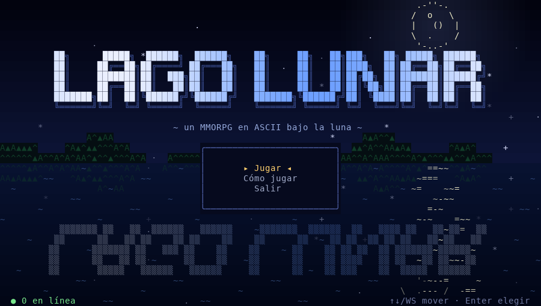

Está hecho en Go con [wish](https://github.com/charmbracelet/wish) y
[bubbletea](https://github.com/charmbracelet/bubbletea). El mundo es un
continente de 3000 x 1200 celdas con bosques, desiertos, ríos, una capital
amurallada y el Lago Lunar, donde empieza todo.

## Capturas

| | |
|---|---|
| 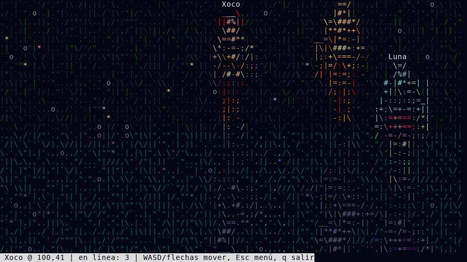 | 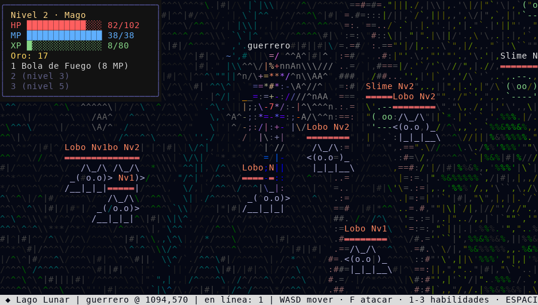 |
| 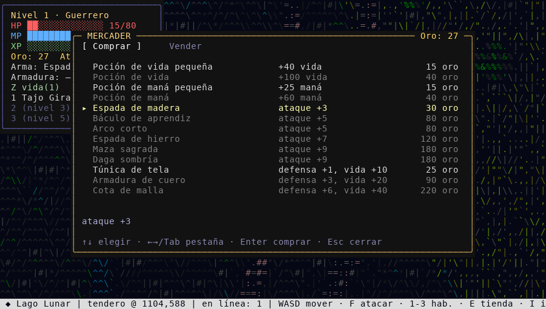 | 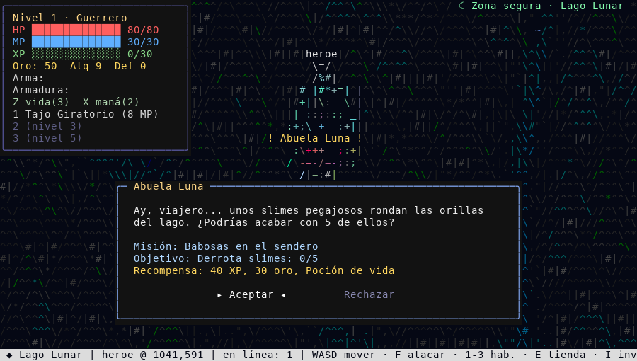 |
| 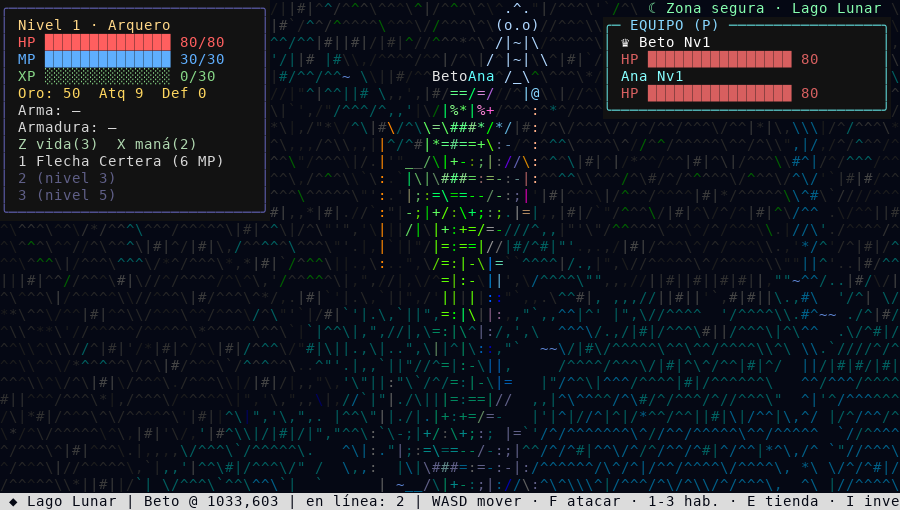 | 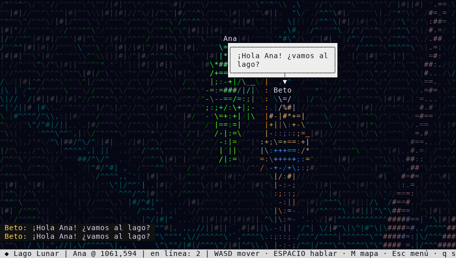 |
| 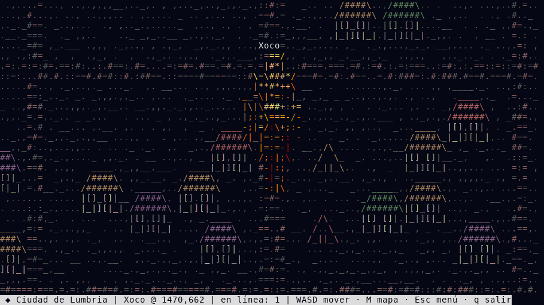 | 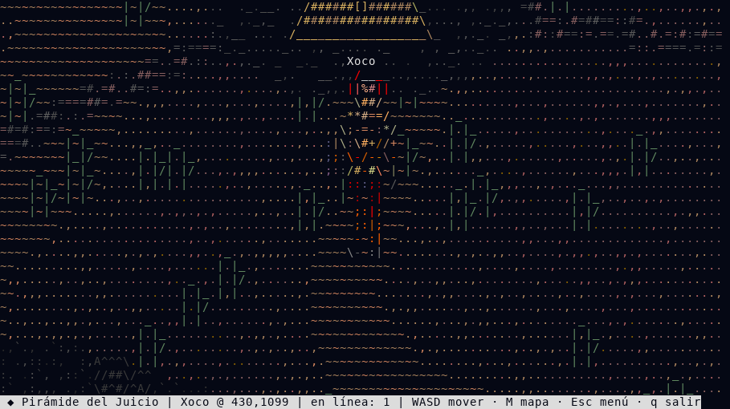 |

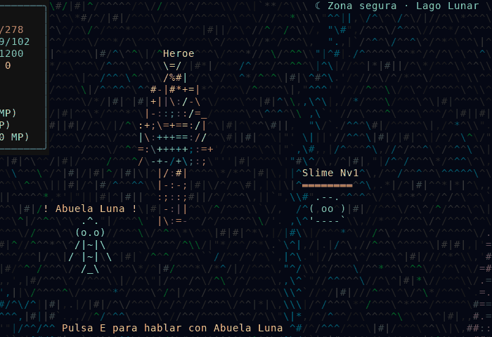

Más imágenes en [docs/img](docs/img), entre ellas el
[mapa completo](docs/img/mapa_completo.png) y el
[panel de admin](docs/img/admin.png).

## Qué tiene

- Mundo compartido: todos los jugadores ven lo mismo en tiempo real.
- 10 personajes en 5 clases (Guerrero, Mago, Arquero, Paladín, Oscuro), cada
  una con tres habilidades que se abren en los niveles 1, 3 y 5.
- Combate con animaciones: poses de ataque, proyectiles con estela, ataques de
  área, retroceso al recibir golpes.
- Enemigos por zonas, de slimes cerca del lago a dragones jóvenes en las orillas
  del mapa.
- Tienda, inventario, pociones, armas y armaduras.
- Misiones con NPCs, zonas seguras y un diario de misiones.
- Equipos de hasta 4 jugadores con XP compartida y chat de equipo.
- Cuentas con contraseña (bcrypt) o partida rápida como invitado.
- Panel de administración y una CLI para ver quién está conectado.
- Funciona en truecolor, 256 o 16 colores. Solo manda al terminal las celdas
  que cambian, así que va bien incluso con conexiones lentas.

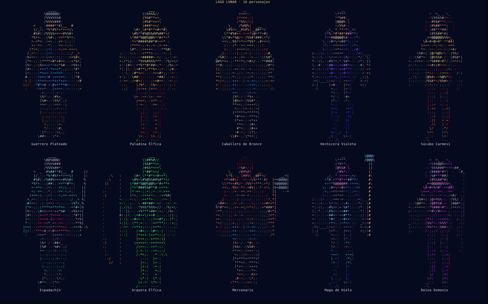

## Controles

| Tecla | Acción |
|---|---|
| W A S D / flechas | moverse |
| F / J | atacar |
| 1 2 3 | habilidades |
| Z / X | poción de vida / maná |
| E | hablar con NPC o abrir la tienda |
| I | inventario |
| L | diario de misiones |
| T | invitar al jugador de al lado al equipo |
| P | ver el equipo |
| S / N | aceptar o rechazar una invitación |
| Espacio | escribir en el chat (`/e mensaje` para el chat de equipo) |
| M | minimapa / mapa completo |
| O o Ctrl+A | panel de admin (solo admins) |
| Esc | volver al menú |
| q | salir |

## Compilar

Hace falta Go 1.27 o más nuevo.

```
go build -o ascii-ssh-game .
```

Para un servidor Linux desde otra máquina:

```
GOOS=linux GOARCH=amd64 go build -o ascii-ssh-game-linux-amd64 .
```

Pruebas:

```
go test -race ./...
```

## Correr el servidor

```
PORT=5230 DATA_DIR=./data ADMINS=tu_cuenta ./ascii-ssh-game
```

| Variable | Para qué | Por defecto |
|---|---|---|
| `PORT` | puerto SSH | `2222` |
| `DATA_DIR` | carpeta de cuentas y bitácoras | `~/ascii-ssh-game/data` |
| `ADMINS` | cuentas admin, separadas por coma | vacío |
| `ADMINS_NO_DEFAULT` | si vale `1`, la cuenta `xo` deja de ser admin | vacío |

La primera vez se crea la llave del host en `.ssh/id_ed25519`, relativa a la
carpeta donde corre el servidor. Guárdala: si cambia, los clientes verán el
aviso de llave distinta.

### Como servicio de systemd

En [deploy/lago-lunar.service](deploy/lago-lunar.service) hay un servicio de
usuario listo para copiar. Supone que el binario está en `~/ascii-ssh-game/`.

```
mkdir -p ~/.config/systemd/user
cp deploy/lago-lunar.service ~/.config/systemd/user/
systemctl --user daemon-reload
systemctl --user enable --now lago-lunar
loginctl enable-linger $USER
```

Para ver los logs: `journalctl --user -u lago-lunar -f`.

## Conectarse

```
ssh -C -p 5230 usuario@host
```

`-C` comprime la conexión y se nota bastante. El usuario de SSH no importa
mucho: dentro del juego puedes entrar con tu cuenta, crear una o jugar como
invitado. Se recomienda una terminal de al menos 100x30.

## Administración

Una cuenta es admin si:

- está en la variable `ADMINS`, o
- tiene `"admin": true` en `accounts.json`, o
- se llama `xo` (a menos que `ADMINS_NO_DEFAULT=1`).

Los invitados nunca son admin, aunque se conecten con ese nombre de usuario.

En el juego, **O** abre el panel con cuatro pestañas: jugadores en línea,
historial de conexiones, cuentas y acciones (teletransportarse a un jugador,
expulsar, silenciar, banear cuenta o IP, quitar el bloqueo por intentos
fallidos y mandar un anuncio a todos).

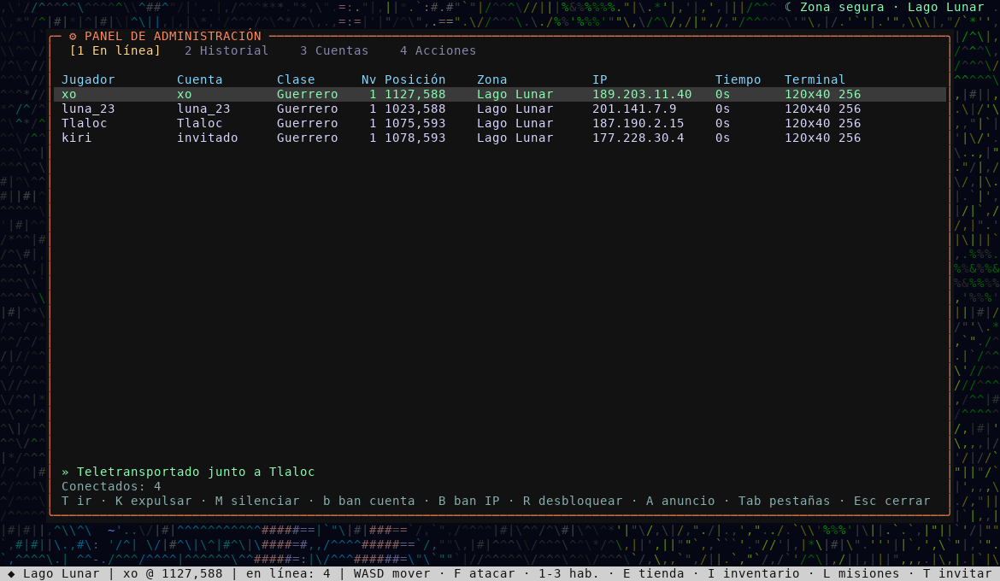

También hay una CLI que lee los archivos de datos, útil por SSH normal:

```
./ascii-ssh-game admin online
./ascii-ssh-game admin historial 50
./ascii-ssh-game admin cuentas
./ascii-ssh-game admin acciones 20
```

Usa la misma `DATA_DIR` que el servidor.

## Archivos de datos

Todo vive en `DATA_DIR`:

| Archivo | Contenido |
|---|---|
| `accounts.json` | cuentas: hash de la contraseña, personaje, nivel, inventario, tiempo jugado |
| `sessions.log` | conexiones, entradas y salidas (una línea JSON por evento) |
| `admin.log` | acciones de los admins |
| `bans.json` | cuentas e IPs baneadas, jugadores silenciados |
| `online.json` | jugadores conectados, se reescribe cada 5 s |

No subas esta carpeta a ningún lado; ya está en `.gitignore`.

## Estructura

```
main.go        sesiones, teclado, cámara y pantalla del juego
world.go       generación del mapa y composición de cada vista
render.go      renderer por diferencias de celdas
color.go       detección de color del terminal y paletas
title.go       pantalla de título y canvas
chars.go       selección y edición de personaje
sprites.go     dibujo de personajes (sprites_gen.go es generado)
combat.go      enemigos, clases, combate y simulación
anim.go        poses de ataque, proyectiles y efectos
items.go       objetos, inventario y NPCs
ui_shop.go     tienda e inventario
quests.go      misiones y zonas seguras
ui_quest.go    diálogos y diario
party.go       equipos
chat.go        chat y globos de diálogo
accounts.go    cuentas, login y formularios
admin.go       panel de admin, bitácoras, baneos y CLI
cmd/           herramientas de prueba (cliente, capturas, prueba de carga)
tools/         scripts de Python para sprites y capturas
deploy/        servicio de systemd
docs/          arquitectura e imágenes
```

Hay una explicación más a fondo en [docs/ARQUITECTURA.md](docs/ARQUITECTURA.md).

## Licencia

MIT. Ver [LICENSE](LICENSE).

Hecho por Xocotzin Granados ([@xoginger](https://github.com/xoginger)).
